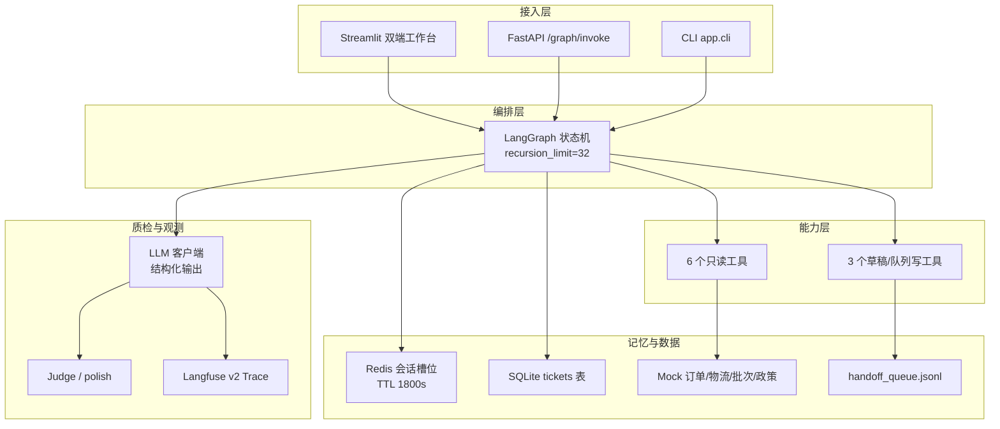
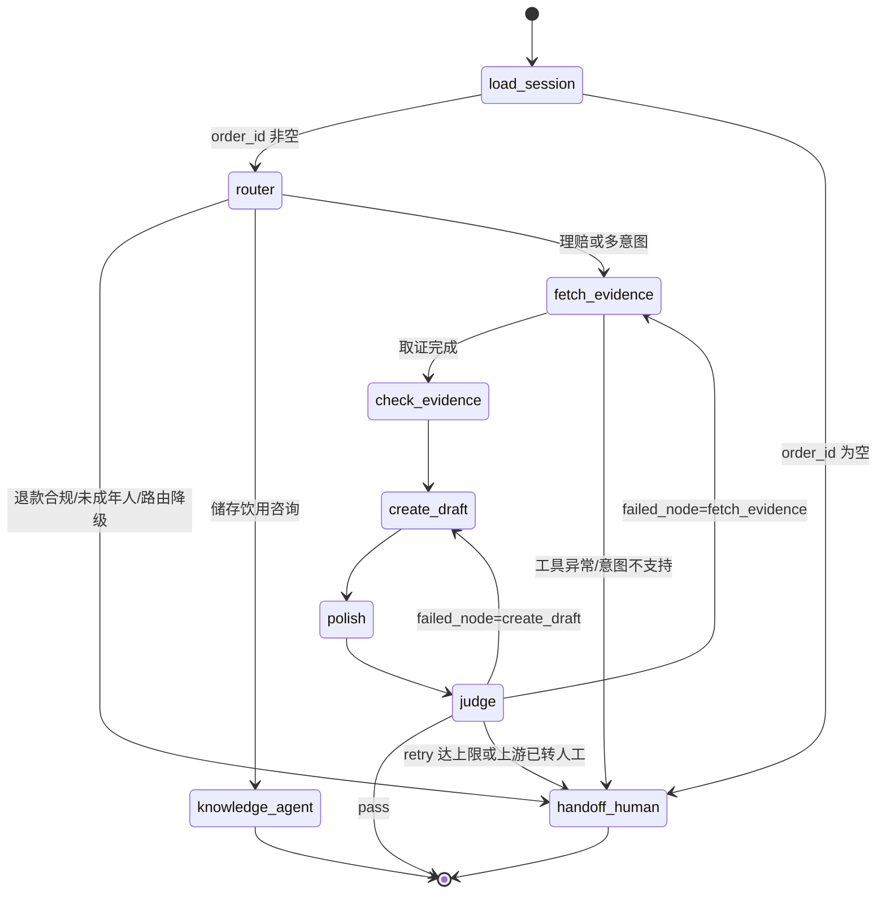
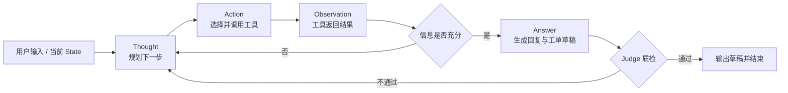

# 架构设计：线上酒类售后理赔客服工单 Agent

本文档对应 **M7 交付基线（2026-11-24）**。重点说明分层结构、确定性编排与自由 ReAct 的设计取舍、LangGraph 状态流转、9 个工具接口、错误码分层、记忆与持久化、路径锚定与异常降级策略。

## 1. 分层结构

设计要点：

- 所有入口共用同一张编译后的图，避免 CLI、HTTP、UI 三套逻辑分叉。
- 工具层无副作用：只读工具查 Mock 数据，写工具只产草稿或队列记录，不退款、不改订单状态。
- 外部依赖（Redis、SQLite、LLM）失败时均降级，不阻断主链路；确定性合规守卫在 LLM 之前生效。

## 2. LangGraph 状态流转图

### 2.1 节点职责

| 节点 | 职责 | 出口条件 |
|---|---|---|
| `load_session` | 按 `session_id` 从 Redis 读取订单与证据槽位；本轮显式输入优先，历史只补空缺 | 有 `order_id` → `router`；为空 → `handoff_human` |
| `router` | 意图识别、多意图拆解、证据槽位抽取、前置合规守卫 | 退款/未成年人/降级 → `handoff_human`；知识咨询 → `knowledge_agent`；其余 → `fetch_evidence` |
| `fetch_evidence` | 按 `task_outputs` 并发取证并计算赔付；结果按原顺序回写 | 成功 → `check_evidence`；异常/不支持意图 → `handoff_human` |
| `check_evidence` | 校验证据完整性，输出缺失项 | 始终 → `create_draft`（缺证走补证路径，不转人工） |
| `create_draft` | 组装工单草稿与回复草稿，写 SQLite/Redis，合并多意图与知识 | 始终 → `polish`；赔付建议为 `handoff_human` 时在 State 置 `handoff=True` |
| `polish` | 只改表达，锁定事实、金额、订单号、编号清单与人工审核承诺 | 始终 → `judge` |
| `judge` | LLM 结构化质检，输出 `pass / reason / failed_node` | 通过 → `END`；失败且未超限 → 回跳；超限 → `handoff_human` |
| `knowledge_agent` | 检索酒知识并生成讲解 | → `END` |
| `handoff_human` | 写转人工队列并记录原因 | → `END` |

说明：`create_draft` 与 `polish`、`judge` 之间是无条件边，因此 `create_draft` 置位的转人工会在 `judge` 路由处统一进入 `handoff_human`。

### 2.2 条件边

| 起点 | 判定 | 目标 |
|---|---|---|
| `load_session` | `handoff=True` | `handoff_human`，否则 `router` |
| `router` | `handoff=True` | `handoff_human` |
| `router` | `intent` 属于知识类，或非多意图且子任务含 `储存饮用咨询` | `knowledge_agent` |
| `router` | 其余 | `fetch_evidence` |
| `fetch_evidence` | `handoff=True` | `handoff_human`，否则 `check_evidence` |
| `judge` | `handoff=True` | `handoff_human` |
| `judge` | `judge_result.pass=True` | `END` |
| `judge` | `retry_count >= 2` | `handoff_human` |
| `judge` | `failed_node=fetch_evidence` | `fetch_evidence` |
| `judge` | 其他失败 | `create_draft` |

### 2.3 关键 State 字段

| 字段 | 类型 | 说明 |
|---|---|---|
| `intent` | `str` | 8 类意图之一 |
| `sub_tasks` | `list[str]` | 路由拆出的子任务名 |
| `task_outputs` | `list[SubTaskState]` | 子任务对象（`task_type / status / result`），多意图并发取证使用 |
| `tool_results` | `dict` | 首个理赔任务的工具结果快照，兼容旧链路 |
| `evidence_status` | `dict` | 证据完整性、缺失项与已有项 |
| `judge_result` | `dict` 或 `None` | Judge 裁决与是否降级 |
| `retry_count` | `int` | Judge 局部重跑次数，上限 2 |
| `judge_feedback` | `str` | 复核意见，注入下一轮草稿 |
| `handoff` / `needs_human` | `bool` | 双写，供图与 CLI 共用 |
| `session_id` | `str` | 多轮会话标识 |
| `ticket_draft` / `reply_draft` | `dict` 或 `None` | 草稿产物 |
| `knowledge_result` | `str` | 酒知识讲解 |
| `error` | `dict` | `code / message / retryable` |

## 3. 设计取舍：确定性编排 vs 自由 ReAct vs Plan-and-Execute

### 3.1 三种架构对比

| 维度 | 本方案：LangGraph 确定性编排 | 备选：自由 ReAct 循环 | 备选：Plan-and-Execute |
|---|---|---|---|
| 可测性 | ✅ 9 节点边界清晰，pytest 可逐节点验证，23 个测试文件 195 条用例稳定通过 | ❌ 步数和顺序不确定，LLM 决策随机性导致难写稳定用例 | ⚠️ 计划层可测但执行层顺序仍有不确定性 |
| 可复现性 | ✅ 相同输入固定路径输出相同，Trace 可完整回放 | ❌ 同一输入多次可能走不同路径 | ⚠️ 部分可复现 |
| 开发复杂度 | 9 节点 + 条件边 + 重试逻辑，约 300 行核心代码 | 需设计行动选择 Prompt + 循环控制 + 上下限守卫 | 需计划层 + 执行层双层 LLM 调用 |
| 适用场景 | 售后理赔（路径固定、规则明确、需强可测） | 开放式探索（研究助理、数据分析、代码审查） | 复杂多步骤任务（数据流水线、项目管理） |
| 成本 | 单次 LLM 调用（router/judge/polish 各一次） | 多轮 LLM 调用，成本高 | 双重 LLM 调用，成本翻倍 |
| 缺点 | 不支持 Agent 自主发现新工具，路径固定时灵活性不足 | 循环上限控制难 + 成本高 + 难写测试 | 双重调用延迟 + 计划层幻觉风险 |

### 3.2 决策依据

本项目场景（售后理赔）路径固定：用户输入 → 路由 → 取证 → 草稿 → 审核，每一步都有明确的业务规则和错误处理路径。
选择确定性编排，**优先保证可测与可复现**——实训交付的核心风险是"系统跑不通"而非"不够灵活"。
同时保留 ReAct 循环保留为扩展设计（见下方），若后续接入开放式工具选择再启用。

### 3.3 ReAct 兜底设计（保留为扩展）

当前主链采用**确定性编排**：由 LangGraph 固定节点顺序调用工具，不开放自由 ReAct 决策，以保证可测、可控、可复现。下图是保留的 ReAct 兜底设计，用于未来接入开放式工具选择：

循环约束：

- 单次请求的图递归上限为 32，Judge 重跑上限为 2，避免死循环。
- 工具异常按 `ToolError` 族保留原错误码，其他异常归为 `INTERNAL`。
- 合规、未成年人、退款诉求不允许进入循环，直接在 `router` 截断。

## 4. 9 个工具接口说明

工具实现位于 `app/tools/readonly.py` 与 `app/tools/write.py`，Schema 位于 `app/tools/schemas.py`。所有返回均含 `meta: {tool, ok, elapsed_ms}`。

### 4.1 只读工具

| 工具 | 功能 | 入参 | 出参 | 错误码 |
|---|---|---|---|---|
| `get_order` | 查询订单、商品、批次、保价与签收时间 | `order_id: str` | `GetOrderOutput{meta, order: OrderInfo}` | `NOT_FOUND` |
| `get_logistics` | 查询物流轨迹、签收状态与异常记录 | `order_id: str` | `GetLogisticsOutput{meta, shipment: ShipmentInfo}` | `NOT_FOUND` |
| `get_batch` | 查询批次出库信息与同批次异常数 | `batch_no: str` | `GetBatchOutput{meta, batch: BatchInfo}` | `NOT_FOUND` |
| `search_policy` | 政策检索；知识类关键词优先命中 `P-KNOW` 系列 | `query: str`，`top_k: int = 3`（1~10） | `SearchPolicyOutput{meta, hits: list[PolicyHit]}` | 无（空结果返回空列表） |
| `check_evidence` | 按问题类型校验证据完整性 | `order_id: str`，`issue_type: Literal["broken_leak","missing_item","wrong_item"]`，`evidence: list[str]` | `CheckEvidenceOutput{meta, status: EvidenceStatus}` | `NOT_FOUND`（订单不存在） |
| `calc_compensation` | 生成赔付建议：补发/部分赔付/补证/转人工 | `order_id: str`，`issue_type`，`evidence_complete: bool` | `CalcCompensationOutput{meta, suggestion: CompensationSuggestion}` | `NOT_FOUND` |

`OrderInfo` 关键字段：`order_id / user_id / sku / product_name / batch_no / quantity / insured / insured_amount / order_amount / signed_at / status`。

`ShipmentInfo` 关键字段：`order_id / waybill_no / carrier / status / signed_at / traces[] / abnormal`。

`EvidenceStatus`：`complete / missing[] / have[]`。

`CompensationSuggestion`：`recommendation`（`partial_refund`、`reship`、`supplement_evidence`、`handoff_human`）、`amount`、`reason`、`policy_ids[]`。

证据要求：

| `issue_type` | 必需证据 |
|---|---|
| `broken_leak` | 开箱视频、面单照片、破损部位照片 |
| `missing_item` | 开箱视频、面单照片、整箱称重照片 |
| `wrong_item` | 开箱视频、面单照片、商品照片 |

### 4.2 草稿与队列写工具

| 工具 | 功能 | 入参 | 出参 | 错误码 |
|---|---|---|---|---|
| `create_ticket_draft` | 生成工单草稿，`need_human_review` 恒为 `True` | `order_id: str`，`issue_type`，`tool_results: TicketToolResults`（订单必填，物流/证据/赔付可选） | `CreateTicketDraftOutput{meta, draft: TicketDraft}` | `INVALID_INPUT` |
| `draft_reply` | 生成顾客回复草稿（补证清单、处理进度、保存建议） | `order_id: str`，`issue_type`，`facts: ReplyFacts`（可为空） | `DraftReplyOutput{meta, reply: ReplyDraft}` | `INVALID_INPUT` |
| `write_handoff_queue` | 追加一条转人工队列记录，等待人工审批 | `order_id: str`，`reason: str` | `{meta, queued: bool, path: str, record: {ts, order_id, reason, status}}` | `INVALID_INPUT` |

写工具的共同边界：

- 不执行退款、不改订单状态、不写审批结果。
- `create_ticket_draft` 的持久化由 `create_draft` 节点负责（SQLite + Redis），工具本身无副作用。
- `write_handoff_queue` 默认写 `data/handoff_queue.jsonl`，可用 `HANDOFF_QUEUE_PATH` 覆盖；测试使用 `tmp_path` 隔离。`_handoff_queue_path()` 同 `_db_path()` 锚定策略（见 §6.5）。

## 5. 错误码约定

### 5.1 工具层错误码（`app/tools/errors.py`）

| 错误码 | 含义 | 可重试 |
|---|---|---|
| `TOOL_ERROR` | 工具通用异常 | 按抛出方设置 |
| `NOT_FOUND` | 订单/物流/批次不存在 | 否 |
| `INVALID_INPUT` | 入参缺失或字段非法 | 否 |
| `DATA_SOURCE` | 数据源不可用（读文件/解析失败） | 否 |

### 5.2 编排与业务层错误码

| 错误码 | 触发点 | 处理 |
|---|---|---|
| `EMPTY_ORDER_ID` | `load_session` | 直接转人工 |
| `COMPLIANCE_REFUND` | `router` 命中退款诉求 | 截断链路，不调用 LLM、不产草稿 |
| `MINOR_PROTECTION` | `router` 命中未成年人购酒/饮酒 | 转人工 |
| `UNSUPPORTED_ISSUE_TYPE` | `fetch_evidence`/`create_draft` 无法映射问题类型 | 转人工，不误算赔付 |
| `AUTO_REFUND_REJECTED` | 赔付建议为 `handoff_human` | 保留草稿并转人工 |
| `JUDGE_REJECTED` | Judge 连续失败达到重试上限 | 转人工并保留复核意见 |
| `INTERNAL` | 节点内未预期异常 | 转人工，不崩溃 |
| `GRAPH_RUNTIME` | CLI 最外层图调用异常 | 返回错误并标记人工 |

### 5.3 错误处理分层与降级策略

| 层 | 策略 | 兜底 |
|---|---|---|
| 工具层 | 抛 `ToolError` 族（保留原错误码） → 图节点捕获 | 其他异常归为 `INTERNAL` |
| 编排层 | 条件边统一判断 `handoff=True` → 转人工 | 递归上限 `RECURSION_LIMIT=32` 防死循环 |
| LLM 层 | Judge/Polish 异常 → 降级放行（标记 `degraded=True`） | 离线环境整链不瘫痪 |
| 持久化层 | Redis 不可用 → 进程内字典降级；SQLite 异常 → 静默降级 | 详见 §6.4 |

## 6. 记忆、持久化与并发

### 6.1 Redis 会话

- Key：`agent:ctx:{session_id}`，Hash 结构，保存 `summary / slots / retry_count / last_active`。
- 槽位包含 `order_id`、`issue_type`、`evidence`、`ticket_draft_id`。
- TTL 默认 1800 秒，读写后滑动续期。
- 连接失败时自动降级为进程内字典，接口语义一致。

### 6.2 SQLite 工单

- 表 `tickets`：`draft_id / order_id / issue_type / summary / status / amount / created_at`。
- `init_db()` 幂等建表，并兼容旧库补 `amount` 列。
- 写入新草稿前将同一 `order_id` 的旧 `draft` 更新为 `superseded`，保证商家端只有一条待审单。
- **路径锚定**：`_db_path()` 优先级 `TICKETS_DB_PATH` > `SQLITE_PATH` > `data/wine_after_sales.db`；env 提供绝对路径时原样放行（Docker Compose 场景 `TICKETS_DB_PATH=/app/data/wine_after_sales.db`）；相对路径强制拼接 `PROJECT_ROOT = Path(__file__).resolve().parents[2]`（sqlite_client.py 在 `app/memory/` 下向上两级），CWD 不影响 SQLite 位置。
- 连接参数 `timeout=5` 处理短时锁竞争；SQL 全用参数化查询，无拼接风险。

### 6.3 并发取证

- `fetch_evidence` 使用 `ThreadPoolExecutor`，`max_workers=min(任务数, 4)`。
- 完成顺序不影响回写顺序，结果按 `task_outputs` 原始顺序写回。
- 单任务失败只标记该任务并触发转人工，不影响其他子任务。

### 6.4 异常处理与降级策略

M7 评审阶段暴露的四类异常场景，现已系统化处理：

| 场景 | 触发条件 | 处理 | 代码位置 |
|---|---|---|---|
| 持久化层静默吞错 | `save_ticket()` / `save_session()` / `write_queue()` 抛异常 | `except Exception: pass`，不阻断主链，但无日志 | `graph.py::create_draft` |
| Redis 退化不恢复 | `_call()` 抛连接异常后切成 `_MemoryClient()` | 永久降级（当前版本） | `redis_client.py::_call` |
| JSONL 队列无并发锁 | 多进程同时 append `handoff_queue.jsonl` | 可能交错（单进程内无问题） | `write.py::write_handoff_queue` |
| UI 展示层异常 | SQLite 路径错 / 锁 / 工单不存在 | 三类差异化提示 + 降级展示 Agent 快照 | `streamlit_app.py::_build_ticket_view` |

**说明**：前三项属"可接受的设计决策"——实训交付环境不涉及多进程并发，但如实记录作为后续优化项。第四项（UI 异常分流）已在 M7 修复并通过 `test_edge_display.py`（14 条）和 `test_display_source.py`（6 条）验证。

### 6.5 路径锚定策略（M7 修复，对应 ⑥ 工程规范）

**问题**：M7 评审发现——`data/wine_after_sales.db` 相对路径跟随 CWD 漂移。在工作区根目录跑验证脚本和在项目目录跑 Streamlit UI，会产生两个不同的 SQLite 文件，导致 UI 提示"工单 TD-xxx 在库中不存在"。

**根因**：`_db_path()` 直接使用 env 值或默认相对路径，没锚定到项目根；`write_handoff_queue()` 同理。

**修复**（三处同源锚定策略）：

| 位置 | 修复代码 |
|---|---|
| `app/memory/sqlite_client.py::_db_path()` | `PROJECT_ROOT = Path(__file__).resolve().parents[2]` |
| `app/tools/write.py::_handoff_queue_path()` | 同上 |
| `ui/streamlit_app.py::_build_ticket_view` | 增加三类异常提示（`unable to open database file` / `database is locked` / 工单不存在）+ 降级展示 Agent 快照 |

**规则**：
- env 提供**绝对路径**时原样放行（Docker Compose 场景：`TICKETS_DB_PATH=/app/data/wine_after_sales.db`）
- env 提供**相对路径**或未设置时，强制拼接 `PROJECT_ROOT`（项目根目录）
- **验证**：23 个测试文件全部通过 env 注入绝对路径（`tmp_path`）实现隔离，不写入真实 `data/`，跑完即清理

## 7. 可观测性

- Langfuse v2 API 上报路由与主链 Trace；`trace_url()` 在 CLI 与 UI 中展示深链。
- 真实 Trace 仅在具备真实凭据时由 `scripts/run_m6_real_traces.py` 生成；离线评测使用 Mock，不产生真实 Trace。
- 指标采集脚本 `scripts/collect_m6_metrics.py` 解析评测日志与用例表，输出 6 项指标报告。
